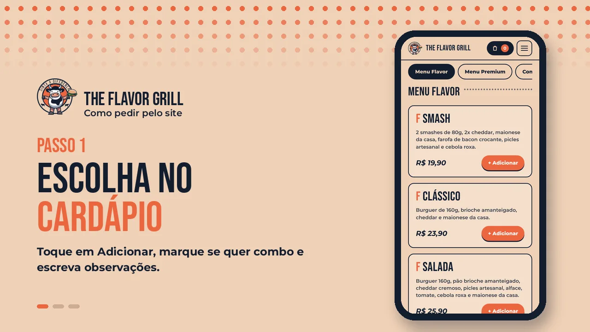

# The Flavor Grill — Site de Delivery

**Site de pedidos da hamburgueria The Flavor Grill. O cliente monta o pedido no site e finaliza direto pelo WhatsApp da loja, sem depender de aplicativos de delivery.**

🔗 **Site publicado:** https://riangustavoll.github.io/the-flavor-grill/

> **Projeto acadêmico.** Este repositório é a entrega da disciplina Desenvolvimento Front-End para Web (Unipê) e não é usado para vender. A loja de verdade, com pagamento online, está em https://flavorgrill.flavorgrill-pb.workers.dev, em um repositório separado.



## Sobre o projeto

Aplicativos de delivery cobram comissão sobre cada venda. A proposta do site é oferecer um canal de **pedido direto**: o cliente escolhe os itens no cardápio, personaliza (combo, observações e quantidade), informa endereço e forma de pagamento e, ao tocar em **Finalizar pedido**, o WhatsApp da loja abre com a mensagem do pedido já organizada.

### Público-alvo

- **Clientes da hamburgueria em João Pessoa (PB)** que pedem delivery pelo celular e já usam o WhatsApp no dia a dia. A linguagem é simples e direta, e o pedido é feito em três passos.
- **A própria loja**, que recebe os pedidos já organizados (itens, valores, endereço e pagamento) e não paga comissão por venda a aplicativos de delivery.

A identidade visual segue o cardápio impresso da marca: fundo pêssego, azul-marinho, laranja, títulos condensados e o mascote da vaca com o slogan *"Sinta a diferença"*.

## Funcionalidades

- **Cardápio por categorias:** Menu Flavor, Menu Premium, Combos e Porções, com abas que acompanham a rolagem da página.
- **Personalização do item:** transformar o burguer em combo (+R$ 15 com batata e refri lata), escolher o refri, escrever observações e definir a quantidade.
- **Promoções:** combo individual e molho grátis em qualquer porção.
- **Sacola:** alterar quantidades, remover itens, esvaziar e ver o subtotal.
- **Finalização:** entrega ou retirada, endereço, pagamento (Pix, cartão ou dinheiro com troco) e observações, com validação nativa do HTML.
- **Pedido pelo WhatsApp:** a mensagem é montada automaticamente com itens, valores, endereço e pagamento.
- **Persistência:** a sacola e os dados do cliente ficam salvos no navegador (`localStorage`) e não se perdem ao recarregar a página.
- **Controle dos dados:** o formulário avisa que nome e endereço ficam salvos só no aparelho e oferece o botão **Esquecer meus dados**, que apaga tudo sem esvaziar a sacola.
- **Vídeo "Como pedir":** apresentação curta do fluxo de compra, com legendas.
- **Layout responsivo:** menu hambúrguer e barra fixa da sacola no celular.
- **Fechamento do dia:** algoritmo que gera um relatório de vendas no console (`js/logica.js`), acessível pela "Área do desenvolvedor" no rodapé.

## Tecnologias utilizadas

- **HTML5:** estrutura semântica (`header`, `nav`, `main`, `section`, `article`, `aside`, `footer`), formulário com validação nativa, vídeo e SVG.
- **CSS3:** variáveis, Flexbox, Grid, media queries, pseudo-classes (`:hover`, `:focus-visible`, `:user-invalid`) e animações.
- **JavaScript:** manipulação do DOM, delegação de eventos e `localStorage`. Sem frameworks.

## Estrutura de pastas

```
the-flavor-grill/
├── index.html
├── css/
│   ├── reset.css          → normaliza os estilos padrão dos navegadores
│   └── style.css          → identidade visual, layout e responsividade
├── js/
│   ├── dados.js           → cardápio, preços, telefone e funções de apoio
│   ├── interface.js       → menu hambúrguer, abas, janelas e avisos
│   ├── cardapio.js        → monta o cardápio e a janela de personalização
│   ├── carrinho.js        → sacola, cálculos e localStorage
│   ├── checkout.js        → formulário e mensagem do WhatsApp
│   └── logica.js          → algoritmo de fechamento do dia (console)
└── assets/
    ├── images/            → logo e capa do vídeo
    ├── media/             → vídeo em WebM e MP4 + licença
    ├── captions/          → legenda do vídeo (.vtt)
    └── fonts/             → fontes locais + licenças
```

## Como executar

**Online:** acesse https://riangustavoll.github.io/the-flavor-grill/ (funciona no computador e no celular).

**No computador:**

1. Clone ou baixe este repositório.
2. Abra a pasta do projeto no Visual Studio Code.
3. Execute o `index.html` com a extensão **Live Server**.
4. Escolha itens no cardápio, abra a sacola e finalize o pedido.

> Abrir o `index.html` direto pelo explorador de arquivos também funciona. Porém, alguns navegadores bloqueiam a legenda do vídeo em endereços `file://`, por isso o Live Server é o recomendado.

Para ver o algoritmo do fechamento do dia: abra o Console (F12), clique em **Área do desenvolvedor** no rodapé e depois em **Simular fechamento do dia**.

## Como editar o cardápio

Preços, itens, telefone e valor do combo ficam todos em `js/dados.js`:

| O que | Onde |
|---|---|
| Número do WhatsApp | `NUMERO_WHATSAPP` (55 + DDD + número, só dígitos) |
| Valor do combo | `PRECO_COMBO` |
| Itens, preços e descrições | lista `CATEGORIAS` |

## Critérios atendidos por aula

| Aula | Como o projeto atende |
|---|---|
| 1 — Git e GitHub | Repositório público com README, `.gitignore`, commits descritivos e trabalho entregue por branch + Pull Request |
| 2 — Fundamentos da Web | `<!DOCTYPE html>`, `charset` e `viewport` no `<head>`; página abre sem erros no console |
| 3 — Semântica e Formulários | Elementos semânticos; todo campo tem `<label for>` ligado ao `id`; `required`, `type`, `minlength` e `min` no formulário |
| 4 — Multimídia | `<video>` com `controls`, `preload="none"` (justificado no código), duas `<source>` (WebM e MP4), `poster` e legenda `<track>` |
| 5 — SVG | Ícones dos passos em SVG com `<title>` e `role="img"`; ícones decorativos com `aria-hidden` |
| 6 — Seletores e Box Model | CSS em arquivos externos, `box-sizing: border-box` no reset, sem `!important` |
| 7 — Flexbox e Grid | Layout feito com `display: flex` e `display: grid`, responsivo em celular, tablet e desktop |
| 8 — Menus e Navegação | Menu hambúrguer no celular (`aria-expanded`), `:hover` e `:focus-visible` nos links |
| 9 — Botões e Formulários | Foco visível em todos os elementos interativos; botão primário (laranja) se destaca do secundário (contorno) |
| 10 — JavaScript | Funções com responsabilidade única, apenas `let`/`const` e nomes descritivos; algoritmo com pseudocódigo e teste de mesa em `logica.js` |
| 11 — DOM e Armazenamento | Scripts com `defer`; sacola salva no `localStorage`; um único ouvinte por lista (delegação de eventos); dados digitados pelo usuário inseridos só com `textContent` |

## Créditos e licenças

| Material | Autoria / origem | Licença ou permissão |
|---|---|---|
| Código (HTML, CSS e JavaScript) | Produzido para este projeto, com apoio de IA (ver abaixo) | Uso acadêmico |
| Logo e mascote da vaca | Criados pelo autor no Canva | Uso conforme os termos de licença do Canva |
| Vídeo "Como pedir" e legenda | Produzidos para este projeto, com capturas do próprio site | Ver [`assets/media/licenca.txt`](assets/media/licenca.txt) |
| Fontes Bebas Neue, Modak e Montserrat | Google Fonts, arquivos do pacote [@fontsource](https://fontsource.org/) | [SIL Open Font License 1.1](https://openfontlicense.org/open-font-license-official-text/) — ver [`assets/fonts/LICENCA-FONTES.txt`](assets/fonts/LICENCA-FONTES.txt) |
| Ícones dos passos e da sacola (SVG) | Desenhados em código para o projeto | Uso acadêmico |
| Ícone do botão do WhatsApp (SVG) | Desenho simplificado, usado só para identificar o botão | A marca WhatsApp pertence à Meta |

**Serviços externos:** o botão de finalizar usa o link `https://wa.me/` do WhatsApp ("clique para conversar"), que só abre a conversa com a mensagem pronta; o envio é feito pelo próprio cliente. A hospedagem é feita pelo GitHub Pages. O site não usa outras APIs nem bibliotecas externas.

## Decisões éticas e profissionais (resumo)

A análise completa está no relatório em PDF entregue na disciplina.

- **Privacidade:** o site pede só os dados necessários para a entrega (nome e endereço). Eles ficam no navegador do cliente, não existe servidor nem banco de dados, e o cliente pode apagá-los a qualquer momento com **Esquecer meus dados**. Nos testes e capturas de tela foram usados dados fictícios.
- **Acessibilidade:** todos os campos têm rótulo, há foco visível para navegação por teclado, textos alternativos nas imagens e legenda no vídeo. Uma verificação de contraste encontrou textos abaixo do mínimo da WCAG AA (ex.: branco sobre laranja, 3,21:1). Eles foram corrigidos e agora ficam entre 4,13:1 e 11,63:1.
- **Sustentabilidade:** imagens em WebP, fontes locais em WOFF2 só com caracteres latinos, vídeo com `preload="none"` (só baixa se a pessoa der play) e nenhum framework ou biblioteca externa.

## Uso de inteligência artificial

O projeto foi desenvolvido com apoio do **Claude (Anthropic)** em código, layout, textos do README e preparação de imagens e do vídeo. As sugestões foram revisadas, testadas no navegador e ajustadas pelo autor, que é responsável pelo conteúdo entregue. Os commits feitos com apoio da IA trazem o Claude como coautor.

## Escopo

Esta versão é um protótipo funcional de front-end. Não há servidor, banco de dados nem pagamento online: o pedido é enviado como mensagem para o WhatsApp da loja, que confirma a taxa de entrega e o valor final.

## Desenvolvimento

**Rian Gustavo Levino Luna**

Projeto desenvolvido na disciplina Desenvolvimento Front-End para Web, do curso de Análise e Desenvolvimento de Sistemas.
